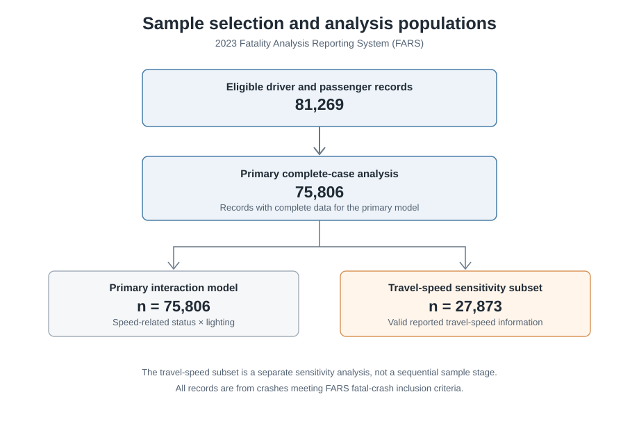
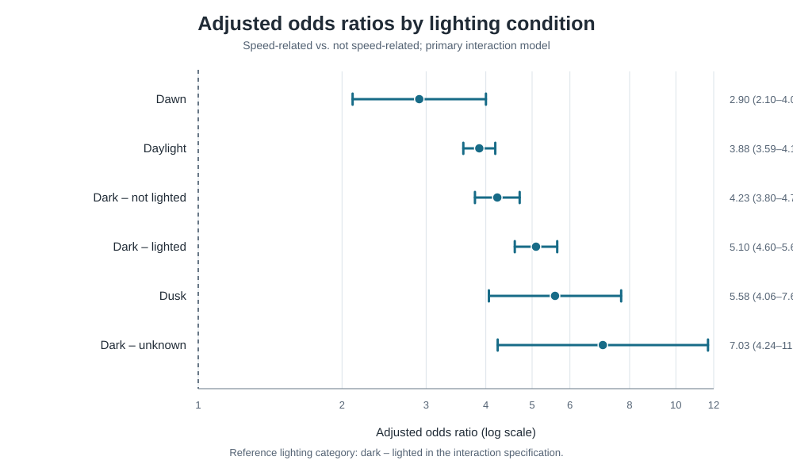
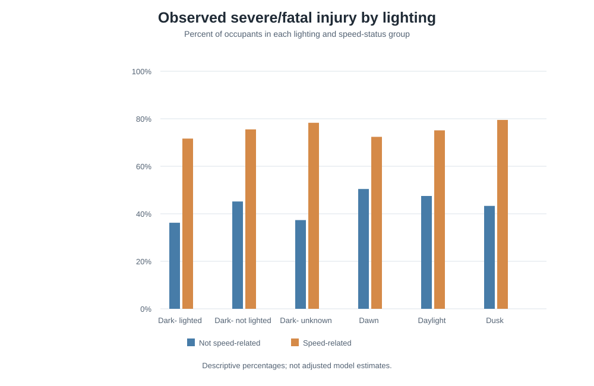
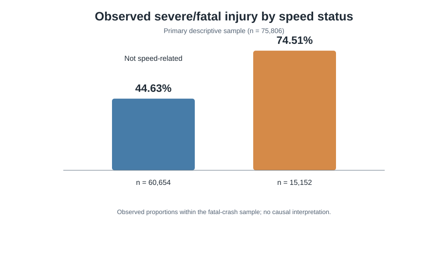

# Speed-Related Factors and Occupant Injury Severity in U.S. Fatal Crashes: A 2023 FARS Analysis

## Project overview

This study examines the association between speed-related crash status and occupant injury severity across six recorded lighting conditions using the 2023 Fatality Analysis Reporting System (FARS). The analysis combines descriptive comparisons with logistic regression and a speed-by-lighting interaction model.

## Research questions

1. How does the observed proportion of severe or fatal injury differ by speed-related status among occupants in fatal crashes?
2. Does the adjusted association between speed-related status and severe or fatal injury vary across recorded lighting conditions?
3. Are the main estimates consistent under alternative model specifications and a reported-travel-speed sensitivity analysis?

## Data and study population

- **Source:** 2023 Fatality Analysis Reporting System (FARS), National Highway Traffic Safety Administration (NHTSA).
- **Unit of analysis:** Eligible driver and passenger records.
- **Initial eligible sample:** 81,269 records.
- **Primary complete-case sample:** 75,806 records.
- **Reported-travel-speed sensitivity subset:** 27,873 records.

The travel-speed subset is a separate sensitivity analysis, not a sequential stage of the primary sample. Raw FARS files are not included in this repository. Researchers should obtain the data and documentation from the official [NHTSA FARS page](https://www.nhtsa.gov/crash-data-systems/fatality-analysis-reporting-system).

## Measures and analytical approach

The primary binary outcome classifies FARS injury-severity codes 3 and 4 as severe or fatal injury; codes 0–2 are grouped as non-severe. For the speed-related indicator, `SPEEDREL = 0` is classified as not speed-related and codes 2–5 as speed-related. Unknown or unclassifiable speed-related codes are excluded from the primary comparison.

The analysis considers six lighting categories: dark–lighted, dark–not lighted, dark–unknown lighting, dawn, daylight, and dusk. Descriptive proportions are reported alongside logistic-regression estimates. The primary interaction model estimates lighting-specific adjusted odds ratios for speed-related versus non-speed-related status. Additional analyses assess an alternative age specification, reported travel speed, and a fatal-only outcome.

## Figures

### Figure 1. Sample selection

### Figure 2. Adjusted odds ratios by lighting condition

Points indicate adjusted odds ratios; horizontal intervals indicate 95% confidence intervals. The reference lighting category in the interaction specification is dark–lighted.

### Figure 3. Observed severe/fatal injury percentages by lighting and speed status

These percentages are descriptive and are not adjusted model estimates.

### Figure 4. Observed severe/fatal injury by speed-related status

## Results

### Descriptive comparison by speed-related status

| Speed-related status | Occupants (n) | Severe/fatal injury (n) | Severe/fatal injury (%) |
|---|---:|---:|---:|
| Not speed-related | 60,654 | 27,072 | 44.63 |
| Speed-related | 15,152 | 11,289 | 74.51 |

The observed proportion of severe or fatal injury was higher among occupants classified as speed-related than among those not classified as speed-related. These figures describe occupants in qualifying fatal crashes and should not be interpreted as injury probabilities for all crashes.

Full counts and percentages are available in [Table_Injury_Severity_by_Speed_Status.csv](outputs/tables/Table_Injury_Severity_by_Speed_Status.csv) and [Table_Injury_Severity_by_Lighting_and_Speed.csv](outputs/tables/Table_Injury_Severity_by_Lighting_and_Speed.csv).

### Lighting-specific adjusted associations

| Lighting condition | Adjusted odds ratio | 95% confidence interval | p-value |
|---|---:|---:|---:|
| Dark – lighted | 5.095 | 4.600–5.644 | <0.001 |
| Dark – not lighted | 4.228 | 3.796–4.709 | <0.001 |
| Dark – unknown lighting | 7.032 | 4.236–11.675 | <0.001 |
| Dawn | 2.902 | 2.105–4.002 | <0.001 |
| Daylight | 3.876 | 3.589–4.187 | <0.001 |
| Dusk | 5.585 | 4.060–7.682 | <0.001 |

The joint robust Wald test for the speed-by-lighting interaction was statistically significant (χ² = 29.85, df = 5, p < 0.001). The lighting-specific estimates indicate that speed-related status was associated with higher adjusted odds of severe/fatal injury in each category; the interaction test indicates variation in these associations across lighting categories.

The full regression estimates are provided in [Table_Adjusted_OR_by_Lighting.csv](outputs/tables/Table_Adjusted_OR_by_Lighting.csv).

### Sensitivity analyses

In the reported-travel-speed subset (n = 27,873), speed-related status remained associated with severe/fatal injury (adjusted OR = 2.935, 95% CI 2.671–3.224). Each 10-mph increase in reported travel speed was associated with higher odds of severe/fatal injury (OR = 1.213, 95% CI 1.192–1.233). In the fatal-only outcome sensitivity analysis, the joint interaction test was not statistically significant at the 0.05 level (robust Wald χ² = 9.87, df = 5, p = 0.079).

## Model comparison

| Model | N | AIC | BIC | Pseudo-R² |
|---|---:|---:|---:|---:|
| Main effects | 75,806 | 98,342.95 | 98,426.07 | 0.0643 |
| Interaction | 75,806 | 98,308.25 | 98,437.56 | 0.0647 |
| Nonlinear age sensitivity | 75,806 | 98,263.59 | 98,402.13 | 0.0651 |

The model comparison is descriptive and should be considered alongside the model specification and sensitivity results. The tabulated values are available in [Table_Model_Comparison.csv](outputs/tables/Table_Model_Comparison.csv).

## Limitations

FARS includes qualifying fatal motor-vehicle crashes. The analysis therefore describes associations among occupants in fatal crashes and does not estimate injury risk across all crashes, including nonfatal crashes. The observational design does not establish causal effects. Lighting categories are recorded crash circumstances and are not direct measurements of visibility or roadway illumination. The travel-speed sensitivity analysis is restricted to records with valid reported travel speed and may reflect a selected subset.

## Repository contents

- The analysis notebook is maintained separately and is not currently included in this repository.
- `outputs/figures/` — figures used in this README.
- `outputs/tables/` — descriptive, regression, and model-comparison tables.
- `LICENSE` — repository license.

## Reproducibility

Reproduction requires the analysis notebook, the relevant 2023 FARS files from NHTSA, and the Python packages used for data processing and modeling. The notebook is not currently included in this repository, and raw source data are not redistributed here.

## Author

Mahfuza Akhter Mishu
